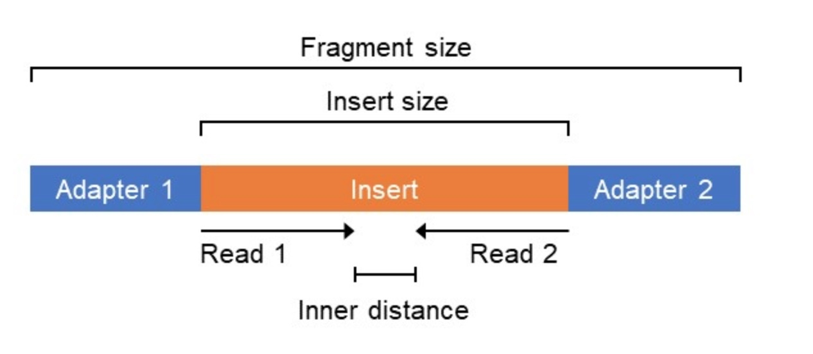
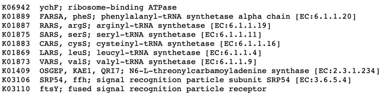



## What you'll learn

- Why raw insert counts can't be compared between genes or between samples.
- How to normalise for **gene length**, **sequencing depth** and **number of cells**, using single-copy marker genes.
- Why relative abundances are **compositional**, and what that means for interpreting them.
- How to compare samples with an ordination, and test a hypothesis with gene abundances.

::: {.lesson-meta}
<span><span aria-hidden="true">⏱</span> **About 60 min**</span>
<span><span aria-hidden="true">💻</span> **Runs in this page:** R in your browser, nothing to install</span>
<span><span aria-hidden="true">📦</span> **Data:** Tara Oceans gene catalog subset</span>
:::





## The data

The counts on this page come from the global ocean study of [Salazar et al. (2019)](https://doi.org/10.1016/j.cell.2019.10.014). The authors built a gene catalog (OM-RGC.v2) from Tara Oceans metagenomes, then mapped the **metagenomic** reads (genes) and **metatranscriptomic** reads (transcripts) of 129 samples back to it. That's Part C of this lesson at the scale of a whole ocean.

To keep the page fast, we use a subset of 12 KEGG orthologs (KOs):

- **10 universal single-copy marker genes**, present once in (almost) every prokaryotic genome;
- **rpoA** and **rpoB** (K03040, K03043), RNA polymerase subunits α and β;
- and, at the end, the cold-shock protein **cspA** (K03704).

| File | Content |
|---|---|
| `tara_samples.csv` | One row per station and depth: metagenome and metatranscriptome IDs, sequencing depth, depth layer, polar or not, temperature, oxygen |
| `tara_gene_slice.csv.gz` | Gene-level insert counts for 12 metagenomes (all genes of the 12 KOs) |
| `tara_ko_sums.csv` | The same, summed per KO, for all 258 samples |
| `tara_top_genes.csv.gz` | Gene-level counts of the 2,000 marker genes found in most metagenomes |
| `tara_cspa.csv` | cspA abundance per cell (already normalised as you'll learn below) |

```{webr}
#| tldr: true
#| autorun: true
#| edit: false
library(dplyr)
library(tidyr)
library(readr)
library(ggplot2)
theme_set(theme_bw())

samples <- read_csv("data/tara_samples.csv", show_col_types = FALSE)
kos <- read_csv("data/tara_kos.csv", show_col_types = FALSE)
genes <- read_csv("data/tara_gene_slice.csv.gz", show_col_types = FALSE)
cat("Loaded", nrow(samples), "samples and", nrow(genes), "gene counts.\n")
```

Have a look at the tables:

```{webr}
samples
genes
kos
```

Each row of `genes` is one catalog gene in one sample: its length in nucleotides, its KO, and the number of **inserts** (read pairs) mapped to it.

## Step 1: gene length

During sequencing, DNA is sheared into inserts, and inserts are drawn at random from all DNA in the sample. **A gene twice as long gets about twice as many inserts**, even if it's equally abundant.

{fig-alt="Diagram of DNA sheared into inserts that are sequenced from both ends." width=70%}

Every cell has one rpoA and one rpoB gene, so their abundances should be equal in every sample. But rpoB is about four times longer than rpoA. Let's see what the raw counts say:

```{webr}
rpo <- genes %>%
  filter(KO %in% c("K03040", "K03043")) %>%
  group_by(sample, KO) %>%
  summarise(inserts = sum(inserts), .groups = "drop") %>%
  pivot_wider(names_from = KO, values_from = inserts)

ggplot(rpo, aes(x = K03040, y = K03043)) +
  geom_point() +
  geom_abline(linetype = 2) +
  labs(x = "rpoA (K03040) inserts", y = "rpoB (K03043) inserts",
       title = "Raw insert counts", subtitle = "Dashed line: equal abundance")
```

The points sit far above the dashed line: rpoB looks about four times more abundant, purely because it's longer.

### Exercise: normalise by gene length

Divide each gene's inserts by its length **before** summing per KO, then redraw the plot. The points should move onto the dashed line.

```{webr}
#| exercise: ex_length
rpo_norm <- genes %>%
  filter(KO %in% c("K03040", "K03043")) %>%
  mutate(inserts_per_bp = ______) %>%
  group_by(sample, KO) %>%
  summarise(inserts_per_bp = sum(inserts_per_bp), .groups = "drop") %>%
  pivot_wider(names_from = KO, values_from = inserts_per_bp)

ggplot(rpo_norm, aes(x = K03040, y = K03043)) +
  geom_point() +
  geom_abline(linetype = 2) +
  labs(x = "rpoA inserts per bp", y = "rpoB inserts per bp")
```

::: {.hint exercise="ex_length"}
Each row has an `inserts` column and a `length` column. Inserts per base pair is one divided by the other.
:::

::: {.solution exercise="ex_length"}
```r
rpo_norm <- genes %>%
  filter(KO %in% c("K03040", "K03043")) %>%
  mutate(inserts_per_bp = inserts / length) %>%
  group_by(sample, KO) %>%
  summarise(inserts_per_bp = sum(inserts_per_bp), .groups = "drop") %>%
  pivot_wider(names_from = KO, values_from = inserts_per_bp)

ggplot(rpo_norm, aes(x = K03040, y = K03043)) +
  geom_point() +
  geom_abline(linetype = 2) +
  labs(x = "rpoA inserts per bp", y = "rpoB inserts per bp")
```
:::

```{webr}
#| exercise: ex_length
#| check: true
ok <- is.data.frame(rpo_norm) &&
  all(c("K03040", "K03043") %in% names(rpo_norm)) &&
  abs(median(rpo_norm$K03043 / rpo_norm$K03040, na.rm = TRUE) - 1) < 0.25
if (ok) {
  list(correct = TRUE, type = "success",
       message = "rpoB and rpoA now have about the same abundance, as expected for two single-copy genes.")
} else {
  list(correct = FALSE, type = "error",
       message = "Not yet: rpoB is still far from rpoA. Did you divide inserts by length before summing?")
}
```

::: {.callout-tip}
## Why divide before summing?
A KO usually contains many catalog genes of different lengths, from different organisms. Normalising each gene by its own length, then summing, gives "how many copies of this function are there", whatever the length of each organism's version.
:::

The file `tara_ko_sums.csv` contains exactly this calculation (`inserts_per_bp`, summed per KO) for all 258 samples. Let's check the ratio across all metagenomes:

```{webr}
#| tldr: true
ko_sums <- read_csv("data/tara_ko_sums.csv", show_col_types = FALSE)

ko_sums %>%
  filter(KO %in% c("K03040", "K03043"), grepl("_METAG$", sample)) %>%
  select(sample, KO, inserts, inserts_per_bp) %>%
  pivot_wider(names_from = KO, values_from = c(inserts, inserts_per_bp)) %>%
  summarise(
    raw_ratio = median(inserts_K03043 / inserts_K03040),
    length_normalised_ratio = median(inserts_per_bp_K03043 / inserts_per_bp_K03040)
  )
```

## Step 2: sequencing depth and cells

Length-normalised abundances still can't be compared **between samples**:

- **Sequencing depth:** a sample sequenced twice as deeply has twice the inserts.
- **Genome size:** communities of organisms with large genomes have fewer copies of any given single-copy gene per sequenced base.

Both are solved by one trick. **Universal single-copy marker genes** (MGs) occur once per cell, so their abundance measures the number of cells sequenced. Dividing by it turns abundances into **copies per cell**.

{fig-alt="Table of the 10 universal single-copy marker genes with their KEGG ortholog IDs." width=70%}

First, check that the marker genes behave as promised: their abundance should follow sequencing depth.

```{webr}
#| tldr: true
marker_kos <- c("K06942", "K01889", "K01887", "K01875", "K01883",
                "K01869", "K01873", "K01409", "K03106", "K03110")

mg_median <- ko_sums %>%
  filter(KO %in% marker_kos) %>%
  group_by(sample) %>%
  summarise(mg_median = median(inserts_per_bp))

mg_median %>%
  inner_join(samples, by = c("sample" = "sample_metag")) %>%
  ggplot(aes(x = sample_metag_nreads / 1e6, y = mg_median)) +
  geom_point(alpha = 0.6) +
  labs(x = "Sequencing depth (million reads)",
       y = "Median marker gene abundance\n(inserts per bp)")
```

They track depth, but not perfectly. The spread comes from differences in genome size and community composition, and those are exactly what we want to correct for, too.

::: {.callout-note}
## Why the median of 10 genes?
Any single marker gene can be mis-annotated or poorly covered in some samples. The median of 10 is robust to one or two misbehaving genes.
:::

### Exercise: genes per cell

Compute copies **per cell** for every KO in every sample: divide `inserts_per_bp` by the sample's `mg_median`. If it worked, single-copy genes such as rpoB should come out at about **1 per cell**.

```{webr}
#| tldr: true
#| exercise: ex_percell
per_cell <- ko_sums %>%
  inner_join(mg_median, by = "sample") %>%
  mutate(per_cell = ______)

per_cell %>%
  filter(grepl("_METAG$", sample)) %>%
  group_by(KO) %>%
  summarise(median_copies_per_cell = median(per_cell)) %>%
  left_join(kos, by = "KO")
```

::: {.hint exercise="ex_percell"}
`per_cell = inserts_per_bp / ______`. What did we just compute for every sample?
:::

::: {.solution exercise="ex_percell"}
```r
per_cell <- ko_sums %>%
  inner_join(mg_median, by = "sample") %>%
  mutate(per_cell = inserts_per_bp / mg_median)

per_cell %>%
  filter(grepl("_METAG$", sample)) %>%
  group_by(KO) %>%
  summarise(median_copies_per_cell = median(per_cell)) %>%
  left_join(kos, by = "KO")
```
:::

```{webr}
#| exercise: ex_percell
#| check: true
pc <- per_cell %>% filter(grepl("_METAG$", sample), KO == "K03043")
if (nrow(pc) > 0 && abs(median(pc$per_cell) - 1) < 0.3) {
  list(correct = TRUE, type = "success",
       message = "rpoB is at about 1 copy per cell. All 12 genes here are single-copy, so all should be close to 1.")
} else {
  list(correct = FALSE, type = "error",
       message = "rpoB should be close to 1 copy per cell. Check what you divide by.")
}
```

```{ojs}
//| echo: false
import {quiz} from "../../assets/quiz.ojs"

quiz("A gene comes out at 0.1 copies per cell in a sample. What does that mean?", [
  {text: "The gene is broken in most cells", correct: false, why: "Abundance tells you how many copies there are, not whether they work."},
  {text: "About 1 in 10 cells in the community carries the gene", correct: true, why: "Per-cell abundance is the average number of copies per cell. For a single-copy gene, 0.1 means roughly 10% of cells have it."},
  {text: "The sample was sequenced too shallowly", correct: false, why: "Dividing by the marker genes removes the effect of sequencing depth."}
])
```

## Step 3: compositionality

Many tools report **relative abundances**: the proportion of each gene or taxon in the sample. Proportions always add up to 1, so if one thing goes up, everything else **must** go down, even if nothing else changed.

Drag the slider to make taxon A bloom. Its absolute abundance changes; B–E stay exactly the same.

```{ojs}
//| echo: false
viewof bloom = Inputs.range([1, 50], {value: 1, step: 1, label: "Taxon A: cells (millions per litre)"})
community = [
  {taxon: "A", cells: bloom},
  {taxon: "B", cells: 8}, {taxon: "C", cells: 6}, {taxon: "D", cells: 4}, {taxon: "E", cells: 2}
]
total = d3.sum(community, d => d.cells)
long = community.flatMap(d => [
  {view: "Absolute (cells)", taxon: d.taxon, value: d.cells},
  {view: "Relative (proportion)", taxon: d.taxon, value: d.cells / total}
])
Plot.plot({
  facet: {data: long, x: "view"},
  fx: {label: null},
  y: {grid: true, label: null},
  color: {legend: true},
  marks: [Plot.barY(long, {fx: "view", x: "taxon", y: "value", fill: "taxon"})],
  height: 260
})
```

In the relative view, taxa B–E seem to **decline** as A blooms, although their cell numbers never changed. Per-cell normalisation avoids this trap for genes: copies per cell don't depend on what else is in the sample. For relative data, use methods designed for compositional data, for example log-ratios.

## Step 4: comparing samples

The marker genes are single-copy, but each catalog gene comes from a particular organism. So the **gene-level** profile of marker genes reflects **who** is in the community, a bit like a taxonomic profile. Let's compare samples with it.

```{webr}
#| tldr: true
top <- read_csv("data/tara_top_genes.csv.gz", show_col_types = FALSE)

# genes per cell for each marker gene in each metagenome, as a sample x gene matrix
profile <- top %>%
  inner_join(mg_median, by = "sample") %>%
  mutate(per_cell = inserts / length / mg_median) %>%
  select(sample, gene, per_cell) %>%
  pivot_wider(names_from = gene, values_from = per_cell, values_fill = 0)

profile_matrix <- as.matrix(profile[, -1])
rownames(profile_matrix) <- profile$sample
dim(profile_matrix)
```

We measure how different two samples are with the **Bray–Curtis dissimilarity**: 0 when the profiles are identical, 1 when they share nothing. It's simple enough to write ourselves:

```{webr}
#| tldr: true
bray_curtis <- function(x) {
  n <- nrow(x)
  d <- matrix(0, n, n, dimnames = list(rownames(x), rownames(x)))
  for (i in seq_len(n)) {
    diff <- abs(sweep(x, 2, x[i, ]))
    both <- sweep(x, 2, x[i, ], "+")
    d[i, ] <- rowSums(diff) / rowSums(both)
  }
  as.dist(d)
}

dissimilarity <- bray_curtis(profile_matrix)
```

A **principal coordinates analysis** (PCoA) places the samples in 2D so that distances in the plot approximate the dissimilarities:

```{webr}
#| tldr: true
pcoa <- cmdscale(dissimilarity, k = 2, eig = TRUE)
explained <- round(100 * pcoa$eig[1:2] / sum(pcoa$eig[pcoa$eig > 0]))

ordination <- tibble(sample = rownames(pcoa$points),
                     PC1 = pcoa$points[, 1], PC2 = pcoa$points[, 2]) %>%
  inner_join(samples, by = c("sample" = "sample_metag"))

ggplot(ordination, aes(PC1, PC2, colour = Layer)) +
  geom_point(size = 2, alpha = 0.8) +
  labs(x = paste0("PCo1 (", explained[1], "%)"), y = paste0("PCo2 (", explained[2], "%)"))
```

### Exercise: what drives the first axis?

Colour the same plot by `polar`, then by `Temperature`. Which variable lines up with the first axis (PCo1)? Use `cor()` to put a number on it.

```{webr}
#| exercise: ex_ordination
ggplot(ordination, aes(PC1, PC2, colour = ______)) +
  geom_point(size = 2, alpha = 0.8)

cor(ordination$PC1, ordination$______, method = "spearman")
```

::: {.hint exercise="ex_ordination"}
Fill in the column name, e.g. `Temperature`, in both blanks. For a continuous variable, add `+ scale_colour_viridis_c()` for a clearer colour scale.
:::

::: {.solution exercise="ex_ordination"}
```r
ggplot(ordination, aes(PC1, PC2, colour = Temperature)) +
  geom_point(size = 2, alpha = 0.8) +
  scale_colour_viridis_c()

cor(ordination$PC1, ordination$Temperature, method = "spearman")
```
Temperature is almost perfectly correlated with the first axis (ρ ≈ −0.95). Polar and non-polar samples sit at opposite ends, and the mesopelagic (MES) samples separate along the second axis. Community composition in the ocean is structured mainly by temperature, which is a key result of the Tara Oceans studies.
:::

## Step 5: a biological question

**Do cold-water communities have more cold-shock protein?** Cold-shock proteins (such as **cspA**, K03704) help bacteria cope with low temperatures. If they matter in the cold ocean, we'd expect more of them per cell in cold samples.

`tara_cspa.csv` has cspA copies per cell, computed exactly as you did above.

```{webr}
#| tldr: true
cspa <- read_csv("data/tara_cspa.csv", show_col_types = FALSE)

cspa_genes <- samples %>%
  inner_join(cspa, by = c("sample_metag" = "sample")) %>%
  rename(genes_per_cell = cspa_per_cell)

ggplot(cspa_genes, aes(Temperature, genes_per_cell, colour = polar)) +
  geom_point(alpha = 0.8) +
  scale_y_log10() +
  labs(x = "Temperature (°C)", y = "cspA genes per cell (log scale)")

cor.test(cspa_genes$genes_per_cell, cspa_genes$Temperature, method = "spearman")
```

Colder samples carry more cspA per cell: the cold-water community has more of the genes it needs to cope with low temperatures.

::: {.callout-tip}
## Genes or activity?
More cspA **genes** doesn't necessarily mean more cspA **activity**. To find out, you need the metatranscriptomes as well: that's [Part 5 of the metatranscriptomics lesson](../metatranscriptomics/05-with-metagenomes.qmd), which starts from exactly these data.
:::

## Your turn

Pick another environmental variable in `samples` (`Oxygen`, `Latitude`, `Layer`) and ask whether cspA genes per cell relate to it. Is the relationship independent of temperature? (Hint: polar samples are cold *and* high-latitude.)

```{webr}
names(samples)
```

## Check yourself

```{ojs}
//| echo: false
quiz("You compare a gene between two samples using raw insert counts. Sample 1 has twice as many. What can you conclude?", [
  {text: "The gene is twice as abundant per cell in sample 1", correct: false, why: "Sample 1 might simply have been sequenced twice as deeply, or contain organisms with smaller genomes."},
  {text: "Nothing yet: you need to normalise for depth and cell number first", correct: true, why: "Divide by gene length and by the marker gene median before comparing samples."},
  {text: "The gene is more highly expressed in sample 1", correct: false, why: "Metagenomic counts measure genes (DNA), not expression."}
])
```

## Key points

- **Length:** longer genes collect more inserts, so divide by gene length before summing genes into functions.
- **Depth and genome size:** divide by the median abundance of 10 single-copy marker genes to get **copies per cell**.
- **Compositionality:** relative abundances can't increase independently; prefer per-cell values, or compositional methods.
- **Genes vs transcripts:** metagenomes tell you a community's functional potential; for its activity, see the [metatranscriptomics lesson](../metatranscriptomics/index.qmd).
