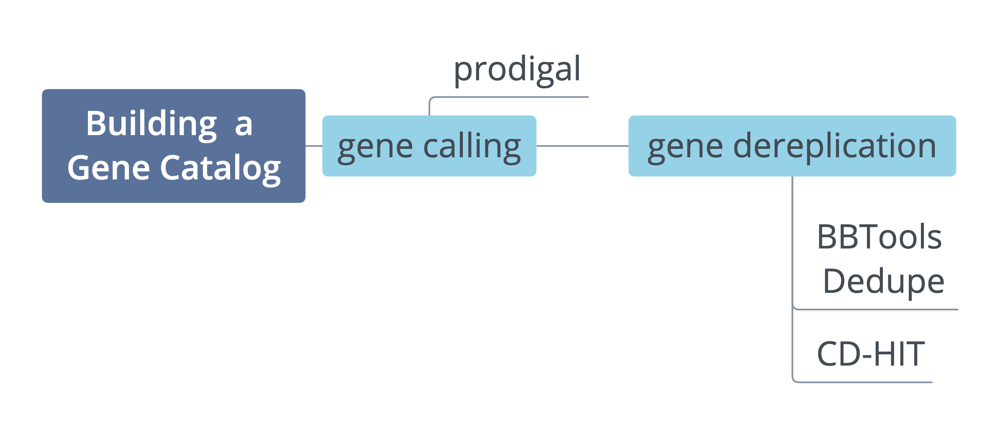

::: {.lesson-meta}
<span>⏱ **About 3 hours** in total</span>
<span>🎯 **Level:** first-year graduate students</span>
<span>🧰 **You need:** a GitHub account, basic shell and R</span>
:::

## What you'll learn

By the end of this lesson you will be able to:

1. Predict protein-coding genes in metagenomic assemblies.
2. Cluster genes from many samples into a non-redundant **gene catalog**.
3. Map reads back to the catalog and count how many inserts each gene gets.
4. Normalise gene abundances for gene length, sequencing depth and the number of cells, and use them to answer a biological question.

## What is a gene catalog?

A gene catalog is a non-redundant collection of genes found in a set of metagenomes. You build it by predicting genes in each sample's assembly, then clustering genes that are nearly identical, so that each gene appears only once. Mapping each sample's reads back to the catalog gives a **gene abundance profile**: how much of each gene is in each sample.

Gene profiles show a community's **functional potential** and diversity. They let you relate genes to environmental factors, or to health and disease.

{fig-alt="Diagram showing genes predicted from metagenomic assemblies of several samples being pooled and clustered into one non-redundant catalog."}

### Catalogs, MAGs or reference profiles?

| Approach | Gives you | Good when |
|---|---|---|
| **Gene catalog** | Abundance of every gene, whatever organism it comes from | You care about functions, or many community members can't be assembled into genomes |
| **MAGs** (metagenome-assembled genomes) | Genomes for the abundant members | You want to know *who* carries a function, or study genome content |
| **Reference-based profiling** (e.g. mOTUs) | Taxonomic composition | You need composition quickly and the environment is well covered by references |

::: {.callout-tip}
## You may not need to build one
Large integrated catalogs already exist for many environments, for example the [global ocean](https://doi.org/10.1016/j.cell.2019.10.014), the [human gut](https://doi.org/10.1038/s41587-020-0603-3) and [many others](https://doi.org/10.1038/s41586-021-04233-4). Mapping your reads to an existing catalog (Part C) can be enough.
:::

## Warm-up

```{ojs}
//| echo: false
import {quiz} from "../../assets/quiz.ojs"

quiz("Two samples contain the same bacterial strain. Its gene for RNA polymerase subunit β is predicted in both assemblies. How many times should it appear in the final catalog?", [
  {text: "Twice, once per sample", correct: false, why: "Then the gene's reads would be split between two catalog entries. Removing this redundancy is the point of clustering."},
  {text: "Once", correct: true, why: "Clustering merges the near-identical copies, so reads from both samples are counted against one gene."},
  {text: "It depends on sequencing depth", correct: false, why: "Depth changes how many reads a gene gets, not how many times it is in the catalog."}
])
```

## The lesson at a glance

```{mermaid}
flowchart LR
  A["Assemblies<br/>(provided)"] --> B["A. Gene calling<br/>prodigal"]
  B --> C["B. Clustering<br/>MMseqs2"]
  C --> D["C. Quantification<br/>bwa + R"]
  D --> E["D. Downstream analysis<br/>R in the browser"]
  E --> F["E. Real projects"]
```

| Part | Where it runs | Time |
|---|---|---|
| [A. Gene calling](01-gene-calling.qmd) | Codespace terminal | 25 min |
| [B. Clustering](02-clustering.qmd) | Codespace terminal + this site | 30 min |
| [C. Quantification](03-quantification.qmd) | Codespace terminal + this site | 40 min |
| [D. Downstream analysis](04-downstream.qmd) | This site (R in your browser) | 60 min |
| [E. Going to real projects](05-production.qmd) | Reading | 10 min |

Part D uses a separate, real dataset, so you can do it on its own, without finishing A–C.

## Set up your workspace (Parts A–C)

Parts A–C run real bioinformatics tools. Instead of installing them, you'll use a **GitHub Codespace**: a Linux computer in the cloud that opens in your browser, with the tools and data ready.

1. Sign in to [GitHub](https://github.com) (create a free account if needed).
2. Click the button below. Creating the Codespace takes a few minutes the first time.

   <a class="codespace-button" href="" target="_blank">Open in GitHub Codespaces</a>

3. When it's ready, a terminal opens in `workshop/gene-catalogs/`. Check that everything is there:

   ```bash
   ls data/scaffolds data/reads
   prodigal -v
   ```

::: {.callout-important}
## Choose the 4-core / 16 GB machine
MMseqs2, the clustering tool in Part B, needs more than 8 GB of memory even for small inputs. The Codespace asks for 4 cores and 16 GB by default; don't downgrade it. Free GitHub accounts include a monthly Codespaces allowance, and **stopping the Codespace when you take a break** saves it.
:::

**Check your work as you go.** At the end of each part, run `./check a` (or `b`, `c`) in the terminal. It compares your results with the reference run.

```{ojs}
//| echo: false
provenance = FileAttachment("data/provenance.json").json()
provenance.provisional
  ? html`<div class="callout callout-style-default callout-warning"><div class="callout-body"><p>⚠️ <strong>Preview data:</strong> the numbers shown in this lesson come from a provisional run (MMseqs2 ${provenance.mmseqs_version} with <code>${provenance.mmseqs_dev_args}</code>). They will change slightly when the official data are built.</p></div></div>`
  : html``
```

[Start Part A →](01-gene-calling.qmd){.btn .btn-primary}
